# System Design — Sports League Management

> **Generated from source code** on 2026-10-24.
> Documents only what is implemented and verified; no planned/future components.

---

## 1. Component Diagram

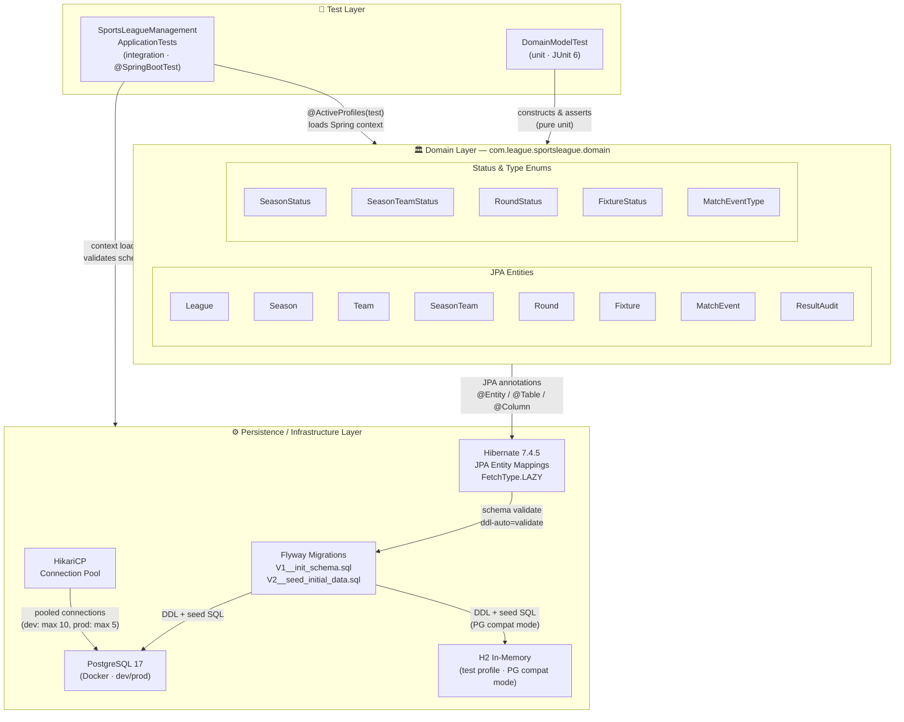

---

## 2. Domain Class Diagram

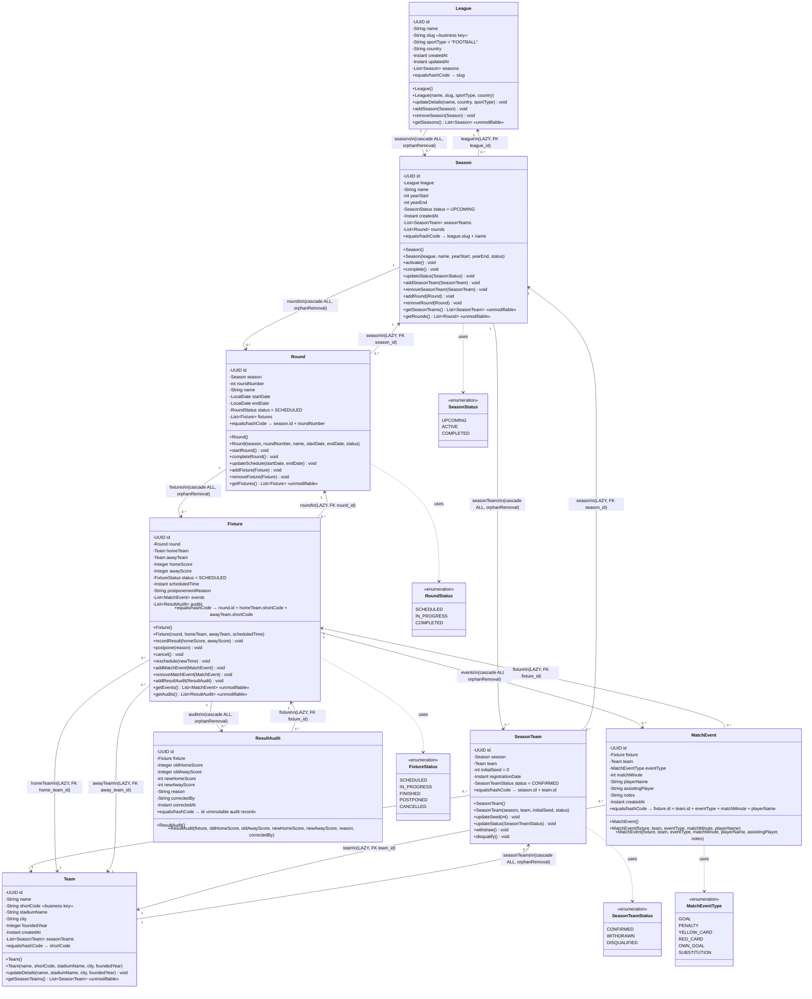

---

## 3. Entity-Relationship Diagram (ERD)

Reflects the exact `V1__init_schema.sql` DDL.

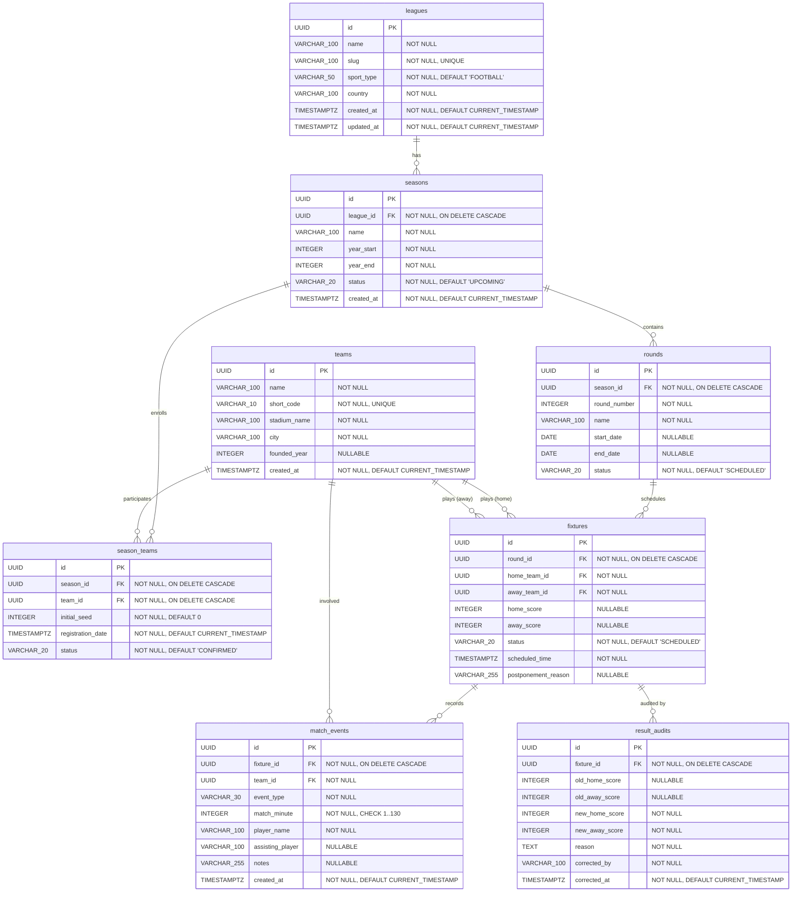

### Constraints & Indexes (from V1 DDL)

| Table | Constraint / Index | Type | Definition |
|---|---|---|---|
| `leagues` | `slug` | UNIQUE | Natural business key |
| `seasons` | `uk_seasons_league_name` | UNIQUE | `(league_id, name)` |
| `seasons` | `idx_seasons_league_id` | INDEX | `league_id` |
| `season_teams` | `uk_season_teams_season_team` | UNIQUE | `(season_id, team_id)` |
| `season_teams` | `idx_season_teams_season_id` | INDEX | `season_id` |
| `season_teams` | `idx_season_teams_team_id` | INDEX | `team_id` |
| `rounds` | `uk_rounds_season_round_number` | UNIQUE | `(season_id, round_number)` |
| `rounds` | `idx_rounds_season_id` | INDEX | `season_id` |
| `fixtures` | `chk_fixtures_different_teams` | CHECK | `home_team_id <> away_team_id` |
| `fixtures` | `idx_fixtures_round_id` | INDEX | `round_id` |
| `fixtures` | `idx_fixtures_home_team_id` | INDEX | `home_team_id` |
| `fixtures` | `idx_fixtures_away_team_id` | INDEX | `away_team_id` |
| `match_events` | `chk_match_events_minute` | CHECK | `match_minute >= 1 AND match_minute <= 130` |
| `match_events` | `idx_match_events_fixture_id` | INDEX | `fixture_id` |
| `match_events` | `idx_match_events_team_id` | INDEX | `team_id` |
| `result_audits` | `idx_result_audits_fixture_id` | INDEX | `fixture_id` |

---

## 4. Aggregate Ownership Diagram

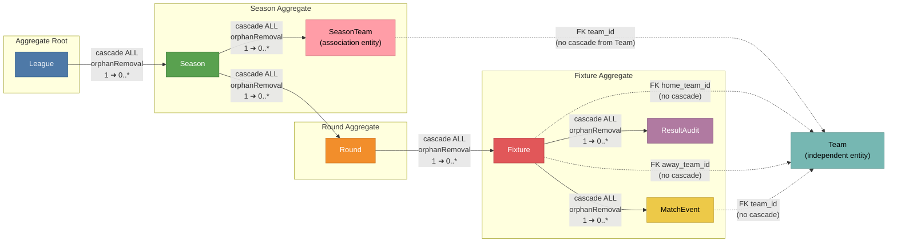

### Cascade Chain Summary

| Parent | Child | Cascade | Orphan Removal | FK ON DELETE |
|---|---|---|---|---|
| League | Season | ALL | ✅ | CASCADE |
| Season | SeasonTeam | ALL | ✅ | CASCADE |
| Season | Round | ALL | ✅ | CASCADE |
| Round | Fixture | ALL | ✅ | CASCADE |
| Fixture | MatchEvent | ALL | ✅ | CASCADE |
| Fixture | ResultAudit | ALL | ✅ | CASCADE |
| Team | SeasonTeam | ALL | ✅ | CASCADE |

---

## 5. Enum State Diagrams

### 5.1 SeasonStatus

Transitions derived from `Season.activate()`, `Season.complete()`, and `Season.updateStatus()`.

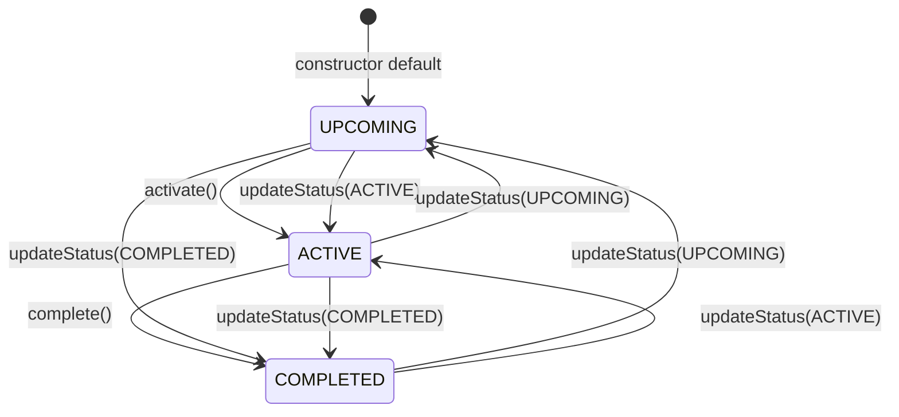

### 5.2 RoundStatus

Transitions derived from `Round.startRound()` and `Round.completeRound()`.

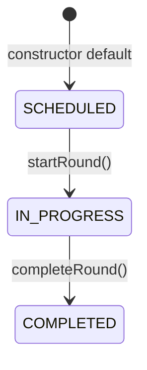

### 5.3 FixtureStatus

Transitions derived from `Fixture.recordResult()`, `Fixture.postpone()`, `Fixture.cancel()`, and `Fixture.reschedule()`.

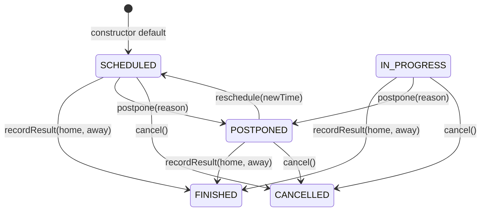

### 5.4 SeasonTeamStatus

Transitions derived from `SeasonTeam.withdraw()`, `SeasonTeam.disqualify()`, and `SeasonTeam.updateStatus()`.

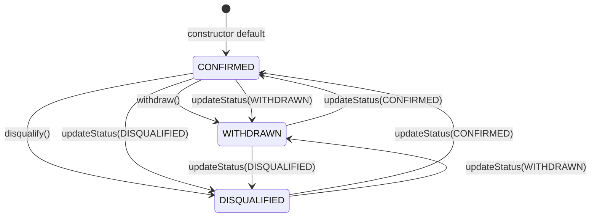

### 5.5 MatchEventType

`MatchEventType` is a classification enum with no state transitions. Values:

| Constant | Description |
|---|---|
| `GOAL` | Regular goal |
| `PENALTY` | Penalty kick |
| `YELLOW_CARD` | Yellow card |
| `RED_CARD` | Red card |
| `OWN_GOAL` | Own goal |
| `SUBSTITUTION` | Player substitution |

---

## 6. Seed Data Summary

All seed data from `V2__seed_initial_data.sql`.

### Leagues

| ID (truncated) | Name | Slug | Sport | Country |
|---|---|---|---|---|
| `1111…1111` | SuperSport HNL | supersport-hnl | FOOTBALL | Croatia |

### Teams

| ID (suffix) | Name | Code | Stadium | City | Founded |
|---|---|---|---|---|---|
| `…2201` | GNK Dinamo Zagreb | DIN | Stadion Maksimir | Zagreb | 1911 |
| `…2202` | HNK Hajduk Split | HAJ | Stadion Poljud | Split | 1911 |
| `…2203` | HNK Rijeka | RIJ | Stadion Rujevica | Rijeka | 1906 |
| `…2204` | NK Osijek | OSI | Opus Arena | Osijek | 1947 |

### Seasons

| ID (truncated) | League | Name | Years | Status |
|---|---|---|---|---|
| `3333…3333` | SuperSport HNL | 2026/2027 Season | 2026–2027 | ACTIVE |

### Season Teams (Enrollments)

| ID (suffix) | Season | Team | Seed | Status |
|---|---|---|---|---|
| `…4401` | 2026/2027 Season | GNK Dinamo Zagreb | 1 | CONFIRMED |
| `…4402` | 2026/2027 Season | HNK Hajduk Split | 2 | CONFIRMED |
| `…4403` | 2026/2027 Season | HNK Rijeka | 3 | CONFIRMED |
| `…4404` | 2026/2027 Season | NK Osijek | 4 | CONFIRMED |

### Rounds

| ID (suffix) | Season | # | Name | Dates | Status |
|---|---|---|---|---|---|
| `…5501` | 2026/2027 Season | 1 | Round 1 | 2026-08-01 → 2026-08-03 | COMPLETED |

### Fixtures

| ID (suffix) | Round | Home | Away | Score | Status | Scheduled |
|---|---|---|---|---|---|---|
| `…6601` | Round 1 | Dinamo (DIN) | Hajduk (HAJ) | 2–1 | FINISHED | 2026-08-02 18:00 UTC |
| `…6602` | Round 1 | Rijeka (RIJ) | Osijek (OSI) | 1–1 | FINISHED | 2026-08-03 20:00 UTC |

### Match Events (Dinamo vs Hajduk only)

| ID (suffix) | Fixture | Team | Type | Min | Player | Assist | Notes |
|---|---|---|---|---|---|---|---|
| `…7701` | DIN vs HAJ | Dinamo | GOAL | 23′ | Bruno Petkovic | Martin Baturina | Left footed strike from penalty area |
| `…7702` | DIN vs HAJ | Hajduk | GOAL | 55′ | Marko Livaja | — | Header from corner kick |
| `…7703` | DIN vs HAJ | Dinamo | GOAL | 89′ | Martin Baturina | Josip Misic | Curling shot into top right corner |

---

## 7. Infrastructure & Configuration

### 7.1 Docker Compose — PostgreSQL

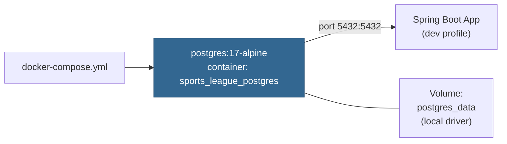

| Setting | Value |
|---|---|
| Image | `postgres:17-alpine` |
| Container name | `sports_league_postgres` |
| Port mapping | `5432:5432` |
| `POSTGRES_DB` | `sports_league_db` |
| `POSTGRES_USER` | `league_admin` |
| Restart policy | `unless-stopped` |
| Healthcheck | `pg_isready -U league_admin -d sports_league_db` (10s interval, 5s timeout, 5 retries) |
| Volume | `postgres_data` (local driver, persistent) |

### 7.2 Application Profiles

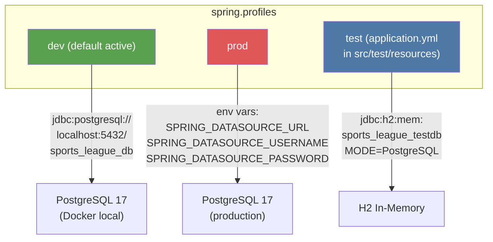

| Property | dev | prod | test |
|---|---|---|---|
| Datasource URL | `jdbc:postgresql://localhost:5432/sports_league_db` | `${SPRING_DATASOURCE_URL}` | `jdbc:h2:mem:sports_league_testdb;…MODE=PostgreSQL` |
| Driver | `org.postgresql.Driver` | `org.postgresql.Driver` | `org.h2.Driver` |
| Dialect | *(auto-detected)* | *(auto-detected)* | `org.hibernate.dialect.H2Dialect` |
| `ddl-auto` | `validate` | `validate` | `validate` |
| `open-in-view` | `false` | `false` | `false` |
| `show-sql` | `false` | `false` | *(not set)* |
| Flyway enabled | `true` | `true` | `true` |
| Flyway locations | `classpath:db/migration` | `classpath:db/migration` | `classpath:db/migration` |
| Flyway baseline-on-migrate | `true` | `true` | *(not set)* |

### 7.3 HikariCP Connection Pool

| Setting | dev | prod |
|---|---|---|
| Pool name | `SportsLeagueHikariCP` | `SportsLeagueHikariCP-Prod` |
| Maximum pool size | 10 | 5 |
| Minimum idle | 5 | 2 |
| Idle timeout | 300 000 ms (5 min) | 300 000 ms (5 min) |
| Connection timeout | 20 000 ms (20 s) | 20 000 ms (20 s) |
| Max lifetime | 1 200 000 ms (20 min) | 1 200 000 ms (20 min) |
| Leak detection threshold | 30 000 ms (30 s) | *(not set)* |

### 7.4 Hibernate Batch Settings (dev profile)

| Property | Value |
|---|---|
| `hibernate.jdbc.batch_size` | 25 |
| `hibernate.order_inserts` | true |
| `hibernate.order_updates` | true |
| `hibernate.format_sql` | true |

### 7.5 Flyway Migration Chain

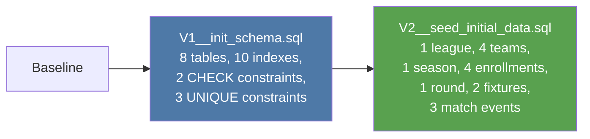
